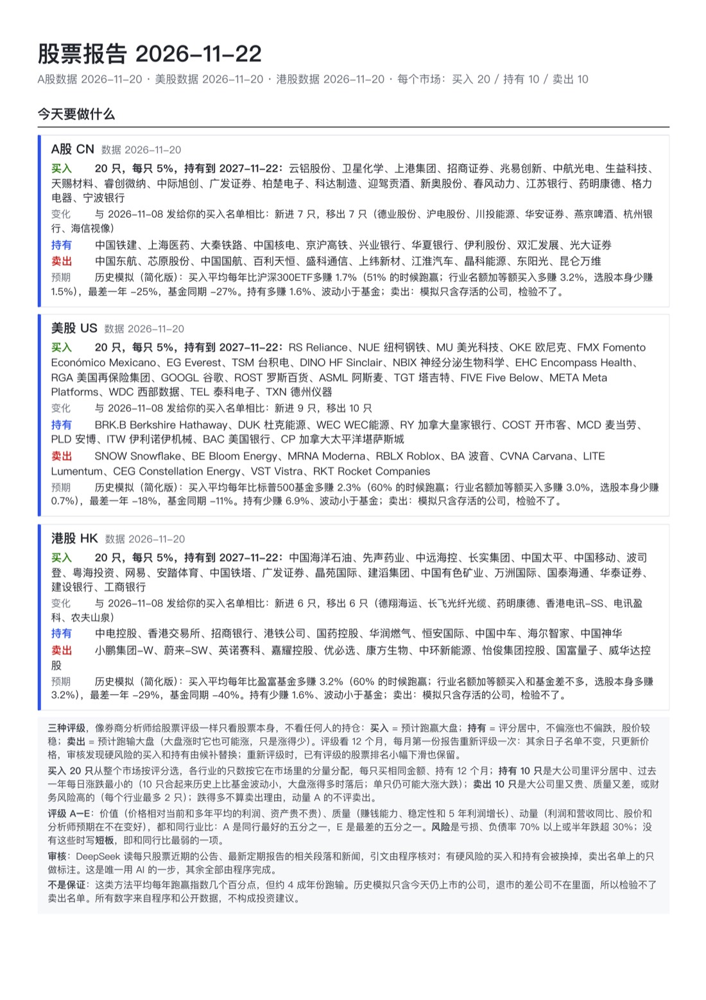
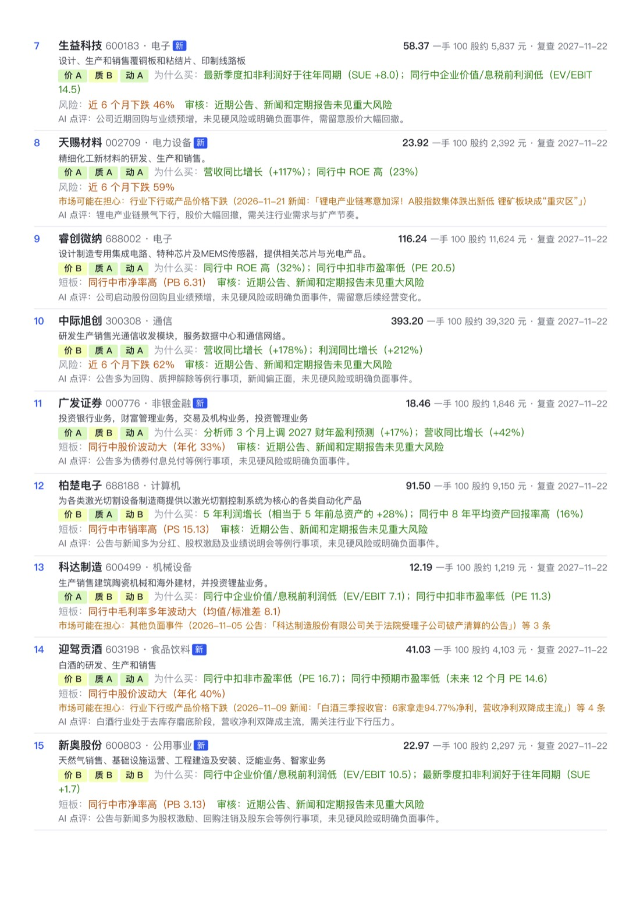
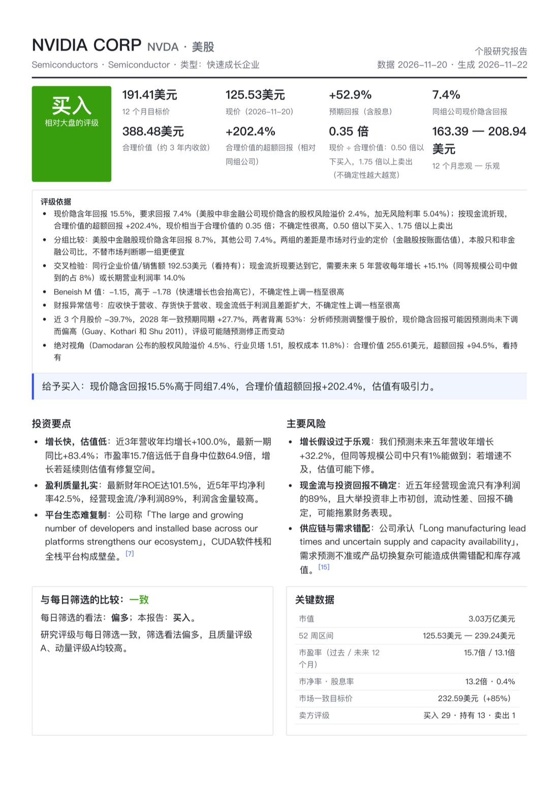
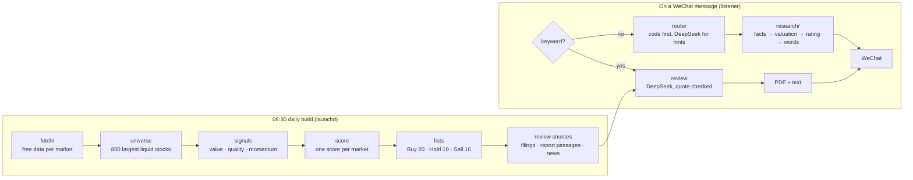

# stock-report

**English** · [简体中文](README.zh-CN.md)

Rule-based **Buy / Hold / Sell ratings for China A-shares, US and Hong Kong stocks**, plus **sell-side style research
reports on any single listed company**, built every day from free data and delivered as a PDF over WeChat.

Every number comes from code and public data. An AI model (DeepSeek) is used only to read filings and news and to
write words, and code checks every quote and figure it writes. The whole thing runs unattended on one Mac.

> **Not investment advice.** This is a personal research project. The lists are the output of a published-factor
> method, not a recommendation to you, and no list is a guarantee.

| Daily screening report (page 1) | A rating card | Single-stock research report (page 1) |
|---|---|---|
|  |  |  |

<sub>Sample pages from the 2026-11-22 build, shown as produced (the reports are in Chinese).</sub>

## Contents

- [What it is trying to achieve](#what-it-is-trying-to-achieve)
- [What it can do](#what-it-can-do)
- [How it works](#how-it-works)
- [Methodology](#methodology)
- [Tech stack](#tech-stack)
- [Data sources](#data-sources)
- [Use it yourself](#use-it-yourself)
- [Commands](#commands)
- [Project layout](#project-layout)
- [Documentation](#documentation)
- [Versions and releases](#versions-and-releases)
- [Limitations](#limitations)
- [License](#license)

## What it is trying to achieve

A private investor who isn't a professional usually has two questions: *"Which stocks are worth owning right now?"* and
*"What should I think of this one company?"*. Professionals answer them with a screening model and an analyst's
research note. This project builds both, for three markets, without paid data, and puts the answer on a phone.

**The goal is deliberately moderate:** beat each market's index fund over the year you hold the names, at about the
market's level of risk. Not a defensive dividend fund, not a concentrated bet on a few hot stocks.

**Honest expectations.** Published factor portfolios of this kind have beaten their index by a few percent a year on
average and lost to it in roughly 4 years out of 10, and their edge shrank after publication (McLean and Pontiff,
2016: about −58%). The report says this on page 1.

Three principles shape every design choice:

1. **Borrow proven methods, don't invent engines.** The screening adapts published recipes (Stockopedia's StockRanks,
   Alpha Architect's Quantitative Value, Greenblatt's Magic Formula, Seeking Alpha's grades, MSCI's factor indexes)
   with each market's ingredients taken from research on that market. It is never tuned to our own backtest.
2. **Numbers from code, words from AI.** The AI never writes a price, forecast, target, rating or score. Its prose can
   only refer to figures by key, which code fills in; any other figure is rejected unless it appears in the source it
   cites.
3. **Keep it small and free.** Free public data only, a few small dependencies, no frameworks, under 2 GB on disk.

## What it can do

### 1. Daily screening report: text **股票报告** or **stock report**

Within about 30 seconds the bot replies with a short text summary and a PDF. For each market (CN, US, HK):

| Rating | How many | Meaning |
|---|---|---|
| 买入 Buy | 20 | Expected to beat the market. Chosen from the whole liquid market, each sector's places in proportion to its share of the market, equal amounts, held 12 months. |
| 持有 Hold | 10 | Expected to be roughly stable: mid-ranked, the steadiest prices among the largest names. |
| 卖出 Sell | 10 | Expected to lag the market: expensive, low-quality or financially distressed large names. |

Each stock gets a card: price, **value / quality / momentum grades (A–E)**, why it is on the list, the key risk, the
cost of one board lot, what the AI review found in its recent filings and news, a short AI note, and a re-check date.
Each market's section also says **what to expect** from each rating, from a history simulation and published research.
Ratings change at the month's first report; on other days only the prices update, and a pick with a newly found hard
red flag is swapped for the next one in line.

### 2. Single-stock research report: text a code or a name

Send `600519`, `0700`, `AAPL`, `贵州茅台`, `茅台`, `腾讯` or `nvidia`. You get an acknowledgement within seconds, then
about 1–2 minutes later a text summary and a ~10-page sell-side style report in Chinese:

- a **rating** (买入 / 持有 / 卖出, or 不评级 when a company can't be valued from free data, such as a pre-revenue biotech)
  and a **12-month target price** with a bear-to-bull range;
- the investment thesis, bull and bear cases, a 3-year forecast and the valuation behind the target;
- business segments, catalysts, risks and an accounting-quality check (Beneish M-score, accrual and cash-flow signals);
- a comparison with the daily screening's view, explaining any large difference.

A company listed in both Shanghai/Shenzhen and Hong Kong (比亚迪, 中国平安) gets one report with a rating per listing.
An ambiguous name (平安) gets a numbered question back. Indexes, funds, crypto and unlisted companies are out of scope.

### 3. A track record

`track` scores every past list against its index fund month by month, and every research rating against what
happened, so the method is judged on its live record, not only on a backtest.

## How it works



- **Daily build.** At 06:30 a launchd job fetches each market's data, scores every stock, builds the lists, gathers
  the sources the review will read, and renders an unreviewed PDF. A few minutes on weekdays, ~30 minutes on Sundays
  when fundamentals refresh.
- **Keyword reply.** The listener polls the WeChat bot. On the keyword it runs the results review (cached, about 10
  seconds), re-renders the PDF and sends it.
- **Any other message** goes to the router: exact codes and full names are matched without AI; otherwise DeepSeek
  suggests which company is meant, and code confirms the guess against the official listings (CNINFO, HKEX, SEC) before
  anything runs. A background worker builds the research report so the listener keeps answering.
- **Graceful failure.** A market whose build fails shows its last good lists with their date. Without DeepSeek the
  screening report still goes out marked 审核暂不可用, and a research report goes out with its numbers and its word
  sections marked 暂不可用. The report as a whole never fails.

## Methodology

The full method, with the research behind every choice, is in [docs/PLAN.md](docs/PLAN.md). In short:

### Screening: one rule-based score per market

- **Universe.** The 800 largest stocks per market after liquidity floors, with at least 12 months of prices. Stocks
  are removed only on facts: data that fails cross-checks with a second source, ST / *ST, suspensions, or a hard red
  flag in a filing. Everything else is left to the score.
- **Score.** Three families with equal weights. Each ingredient is a percentile among the stock's sector peers
  (financials ranked apart); each family is the rank of its ingredients' mean; the score is the mean of the families.

  | Family | Ingredients (vary by market, from each market's research) |
  |---|---|
  | 价值 Value | E/P (CN: on 扣非 recurring profit), forward E/P, B/P, S/P, EBIT/EV, dividend yield, E/P on the 5–8-year average profit |
  | 质量 Quality | ROE (US: gross profit ÷ assets), cash backing of profit, leverage, 8-year ROA, margin stability, low volatility, 5-year profit growth over assets |
  | 动量 Momentum | 12-1-month price return (CN: earnings surprise instead, as A-share research finds price momentum doesn't pay), profit growth, revenue growth, analyst revisions |

- **Lists.** Buy takes each sector's best scores, with sector places set by the sector's share of free-float market
  value, after screening out the 5% most likely distressed or with the largest accruals (Quantitative Value). A rated
  name keeps its place until it falls past 120% of the cut-off (the buffer rule MSCI and CSI indexes use), which keeps
  turnover low. Hold and Sell come from the 400 largest, at most 2 per sector.
- **Results review.** The screening's one AI step. DeepSeek reads each listed name's recent non-routine filings, the
  relevant passages of its latest periodic report and recent headlines, and flags findings that must each quote a
  source. Code checks every quote verbatim. A hard red flag from a filing (fraud, insolvency, an agreed sale of the
  company…) swaps the pick for the next one; soft concerns are shown on the card.
- **What to expect.** A history simulation per market over month ends from about 2018 to 2026, rerun after each
  method change and never used to tune the method. As of v4.2 (2026-11-22) it shows the Buy list beating the index
  fund by about +1.7% a year in CN, +2.3% in the US and +3.2% in HK, in 51–60% of years. These figures have a
  survivorship bias the report names, so they are an indication, not a promise. Details in
  [docs/BACKTEST.md](docs/BACKTEST.md).

### Research reports: valuation by type of company

- **Fact sheet.** Code assembles every figure for one company: years of statements from the regulator or exchange data
  (SEC XBRL, Eastmoney's statement tables), a second source for each figure (Yahoo), consensus forecasts, prices, peers
  and Damodaran's published industry data.
- **Playbook by company type** (after Damodaran's life-cycle approach): ordinary business, fast grower, loss-maker,
  pre-revenue, bank, insurer, broker, cyclical, utility / high-dividend, REIT or holding company. Each type has its own
  main valuation and cross-checks, such as a 10-year FCFF DCF, an excess-return model on book equity for financials, a
  normal-year DCF for cyclicals, or a dividend discount model.
- **Measured assumptions.** Growth fades to base rates measured on thousands of companies (how often a company of that
  size has kept such growth); margins and excess returns fade at measured rates; a moat graded from data sets how long
  returns stay above the cost of capital (Morningstar's three-stage structure).
- **Rating.** The return today's price implies against the return the market's own price implies under the same rules
  (Damodaran's implied-premium method), with an uncertainty band widened by accounting and risk checks. The 12-month
  target closes part of the gap to fair value.
- **Words.** DeepSeek writes the business description, thesis, bull and bear cases, risks and the comparison, from the
  fact sheet and sources code gives it. Any figure it writes must be a fact-sheet key or appear in the cited source;
  quotes are checked verbatim.

## Tech stack

| Layer | What is used |
|---|---|
| Language and packaging | Python 3.12, [uv](https://docs.astral.sh/uv/) (`uv.lock` pins every version) |
| Data and math | pandas, httpx (HTTP), xlrd (Excel files from Damodaran, CSI and HKEX), pypdf (filing PDFs) |
| Reports | Jinja2 HTML templates rendered to PDF by headless Google Chrome |
| AI | DeepSeek API (`deepseek-flash`), three narrow uses: reading the message, the results review, the research report's words |
| Delivery | Node.js helper (`bridge/wechat.mjs`) over the `cli-wechat-bridge` npm package |
| Scheduling | macOS launchd: the 06:30 daily build and the always-on listener |
| Tests | pytest on saved data samples: scoring and valuation math, parsers, one end-to-end dry run |
| Releases | GitHub Actions: semantic version tags and release notes on every push to `main` |

About 12,500 lines of app Python in `stockreport/`, plus the backtest harness in `backtest/`.

## Data sources

All free and public. Each module in `stockreport/fetch/` handles one source; raw downloads are temporary and only
small extracted tables are kept.

| Market | Prices and quotes | Fundamentals and forecasts | Filings and news | Other |
|---|---|---|---|---|
| China A-shares | 通达信 TDX daily packages, Tencent quotes (cross-check) | Eastmoney datacenter (statements, valuation, consensus) | CNINFO announcements, Eastmoney news | 申万 industries, CSI 300 weights, ChinaBond 10-year yield |
| US | Yahoo chart API, Nasdaq screener | SEC EDGAR companyfacts (XBRL), Nasdaq consensus, Yahoo (cross-check) | SEC filing index, Yahoo news | FRED 10-year Treasury yield |
| Hong Kong | Yahoo chart API, Tencent | Eastmoney HK tables (statements, main indicators), Yahoo consensus | HKEXnews, Eastmoney news | HKEX board lots, HK Government Bond yields |
| Research | | Damodaran's datasets (country risk premiums, industry betas, margins, ratings table) | | |

`crosscheck.py` compares each market's key figures with a second source every day and raises drift alarms.

## Use it yourself

You can use the repo at three levels: read the method, run the reports on your own machine, or adapt them.

### Requirements

- macOS (launchd and the Chrome path; see "Running elsewhere" below), Google Chrome, [uv](https://docs.astral.sh/uv/)
- Node 18+ and a WeChat bot via `cli-wechat-bridge`, **only** if you want WeChat delivery
- A DeepSeek API key, **only** for the AI review and the research reports' words

### Quick start: a screening PDF without WeChat or AI

```bash
git clone https://github.com/fanyang0610/stock-report.git
cd stock-report
uv sync
uv run python -m stockreport run --market cn     # first run backfills ~13 months of prices (~40 min)
open reports/$(date +%F)/report.pdf
```

The China market needs no keys. For the US add `SEC_USER_AGENT` and `FRED_API_KEY` to `.env`; Hong Kong needs none.
A single company: `uv run python -m stockreport research 600519` writes `reports/<date>/research_600519.pdf`
(without a DeepSeek key its word sections are marked 暂不可用, the numbers are all there).

### Configuration: `.env` (never committed)

| Variable | Needed for |
|---|---|
| `SEC_USER_AGENT` | US data: your name and contact email, which the SEC requires |
| `FRED_API_KEY` | US risk-free rate (a free key from FRED) |
| `DEEPSEEK_API_KEY` | the results review, reading messages, the research report's words |
| `EQUITYSIGNALS_WECHAT_RECIPIENT_ID` | who receives the WeChat report |

List sizes, thresholds, retention periods and the DeepSeek model are in [config.toml](config.toml), each commented
with the section of the plan that explains it.

### Full setup: WeChat delivery on a schedule

1. Install the `cli-wechat-bridge` npm package globally. `bridge/wechat.mjs` looks for it under
   `~/.npm-global/lib/node_modules/` (or set `CLI_WECHAT_BRIDGE_TRANSPORT` to its `wechat-transport.js`). Log in to the bot with `wechat-setup`, and check it with `node bridge/wechat.mjs status`.
2. Load every market once: `uv run python -m stockreport fetch --market cn` (and `us`, `hk`).
3. Install the two launchd jobs:

   ```bash
   cp launchd/com.stockreport.daily.plist launchd/com.stockreport.listen.plist ~/Library/LaunchAgents/
   launchctl bootstrap gui/$(id -u) ~/Library/LaunchAgents/com.stockreport.daily.plist
   launchctl bootstrap gui/$(id -u) ~/Library/LaunchAgents/com.stockreport.listen.plist
   ```

   The plists contain absolute paths to this checkout: edit them if yours differs. Remove a job with
   `launchctl bootout gui/$(id -u)/com.stockreport.daily` (or `.listen`). The listener polls for ~55 s and launchd
   restarts it 10 s later; only one process may poll the bot. A WeChat bot can only reply for a while after you last
   messaged it, so if `status` says it isn't ready, text it first. Logs are in `logs/`.

### Running elsewhere, and adapting it

- **Linux or Windows:** set `CHROME` in [stockreport/render/\_\_init\_\_.py](stockreport/render/__init__.py) to your
  Chrome or Chromium binary and schedule `run` with cron or Task Scheduler instead of launchd.
- **Without WeChat:** `run` and `research` write the PDF and the text summary to `reports/<date>/`; send them any way
  you like. Delivery lives in `deliver.py` and `bridge/` only.
- **Another market or method:** each market's ingredients and rules are written down with their sources in
  [docs/PLAN.md](docs/PLAN.md); the per-market code paths are in `universe.py`, `signals.py` and `research/{cn,us,hk}.py`.
- **With a coding agent:** [AGENTS.md](AGENTS.md) holds the rules the project was built under (free data only,
  numbers from code, one stage at a time) and works as instructions for Claude Code or similar tools.

## Commands

```bash
uv run python -m stockreport run [--market cn|us|hk]   # fetch, score, lists, review sources, PDF (no AI) -> reports/<date>/
uv run python -m stockreport review                    # results review (DeepSeek), then the reviewed PDF and summary
uv run python -m stockreport send [--test]             # review, then send to WeChat; --test sends sample data
uv run python -m stockreport listen                    # the listener: keyword reply and the router
uv run python -m stockreport research CODE             # a research report -> reports/<date>/research_CODE.pdf
uv run python -m stockreport research CODE --facts     # its fact sheet only -> data/research/<market>/<code>/facts.json
uv run python -m stockreport research CODE --value     # its valuation, target and rating only -> valuation.json
uv run python -m stockreport track                     # scorecard: past lists vs the index fund, and the research record
uv run python -m stockreport verdict [CODE veto|confirm --until DATE --reason "..."]   # your overrides (no args: list)
uv run python -m stockreport cleanup [--dry-run]       # apply storage retention, show disk use
uv run pytest                                          # tests
```

A **verdict** lets you keep a name off Buy and Hold (`veto`) or overrule a soft concern (`confirm`) until a date. It
never changes a number.

Refreshing the "what to expect" figures after a method change: `uv run python -m backtest.run build cn|us|hk`, then
`uv run python -m backtest.qvm frame cn|us|hk` and `uv run python -m backtest.qvm run cn|us|hk`
([docs/BACKTEST.md](docs/BACKTEST.md)).

## Project layout

```
stockreport/            the app
  fetch/                one module per data source
  universe.py           which stocks are scored
  signals.py            value, quality and momentum ingredients; the distress probability
  score.py              families, score, grades, card lines
  lists.py              Buy, Hold, Sell; the buffer and the monthly review calendar
  review.py             the results review (with passages.py, events.py, quotes.py, notes.py, verdicts.py)
  report.py, render/    HTML -> PDF and the text summary
  deliver.py            WeChat sending; listener.py answers messages
  research/             single-stock research: data and fact sheet, valuation (value.py, dcf.py, fade.py, market.py),
                        rating (rating.py, judge.py), words (words.py, texts.py), report, router, background queue
  track.py, history.py  scorecard and multi-year tables; crosscheck.py second-source checks; cleanup.py retention
bridge/wechat.mjs       Node helper for the WeChat bot
backtest/               backtest harness and data builders (not part of the app)
launchd/                the two launchd jobs
tests/                  pytest, with small saved data samples in tests/data/
docs/                   the plan, backtest results, method reviews, images, archive
data/ reports/ logs/    caches and outputs (git-ignored, kept under 2 GB)
```

## Documentation

| File | What it holds |
|---|---|
| [docs/PLAN.md](docs/PLAN.md) | The method, the research behind each choice, the stages and their status. The main reference. |
| [docs/BACKTEST.md](docs/BACKTEST.md) | History simulations: results, and the commands that produce them. |
| [docs/reviews/](docs/reviews/) | Independent method reviews whose findings drove later stages (2026-11-13 method review, 2026-11-15 lists check). |
| [AGENTS.md](AGENTS.md) | Rules for coding agents working on the project (`CLAUDE.md` links to it). |
| [docs/archive/](docs/archive/) | Earlier plans and reviews (the v0 valuation engines, the 2026-10-22 plan). Reference only. |

## Versions and releases

Versions follow `MAJOR.MINOR.PATCH`, live as git tags, and have notes on the
[Releases page](https://github.com/fanyang0610/stock-report/releases). The size of a bump follows how much the change
matters to what you get:

| Level | When | Example |
|---|---|---|
| **major** | The method or the meaning of the ratings changes | a new ranking method; lists rebuilt on a different rule |
| **minor** | A new capability, or a change to what is bought, held, sold or what the report says to expect | a stage completed; a new score ingredient |
| **patch** | A fix that keeps the method | a data parsing fix; a review rule corrected |
| **none** | Nothing the app does changes | docs, tests, backtest scripts |

A GitHub Action ([.github/workflows/release.yml](.github/workflows/release.yml), logic in
[.github/release.sh](.github/release.sh)) runs on every push to `main`. Each commit states its level with a trailer line
`Release: major|minor|patch|none`; without one, the Action infers it: a commit starting "Stage *n*" that changes app
files is minor, any other change to app files (`stockreport/`, `bridge/`, `launchd/`, `config.toml`, `pyproject.toml`,
`uv.lock`) is patch, everything else is none. The largest level in a push wins, and the release is titled after the
change that set it. Preview with `bash .github/release.sh --dry-run`. Nothing is tagged by hand, and `pyproject.toml`'s
version is not used: the latest tag is the version.

### Version history

| Versions | Dates | What changed |
|---|---|---|
| v0.1 – v0.5 (pre-releases) | 2026-10-17 → 10-22 | Earlier engines: peer valuation, per-stock fair values, an earnings-forecast engine. They didn't pass their own tests and were replaced. Kept as history. |
| v1.0 – v1.4 | 2026-11-02 → 11-08 | The current screening method goes live: the factor score, Buy / Hold / Sell per market, the AI results review, the forward scorecard. |
| v2.0 – v2.2 | 2026-11-12 → 11-13 | Single-stock research reports: fact sheet, valuation and rating by company type, AI-written words with checks, the WeChat router, business segments. |
| v3.0 | 2026-11-21 → 11-22 | Screening rework after an independent review: three families instead of four, the average-profit P/E, the 20% buffer, Sell redefined as expensive junk. |
| v4.0 – v4.2 | 2026-11-22 | Research valuation rebuilt on measured assumptions and the market's implied return; Sell skips the momentum leaders; ratings change once a month. |

## Limitations

- **Free data has gaps.** A stock whose figures are missing or disagree between sources is dropped, not guessed.
- **Survivorship.** The history simulation contains only companies listed today, so it flatters Buy and can't test
  Sell; the report states this.
- **Single machine.** The scheduled setup is built for one Mac with one WeChat bot; it is not a hosted service.
- **Not advice.** The ratings come from a published-factor method applied mechanically. They don't know your
  situation, and the report never advises how to split your money between stocks, funds and bonds.

## License

No license has been chosen yet, so default copyright applies: you may read and fork the code on GitHub, but reuse
needs the author's permission. Please open an issue to ask.
