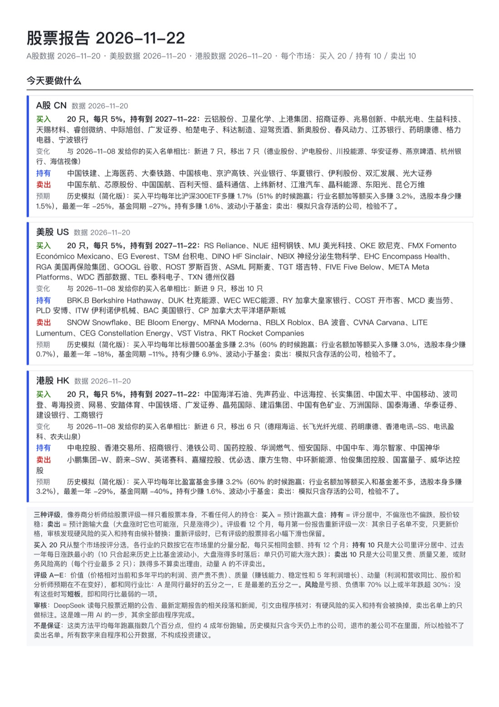
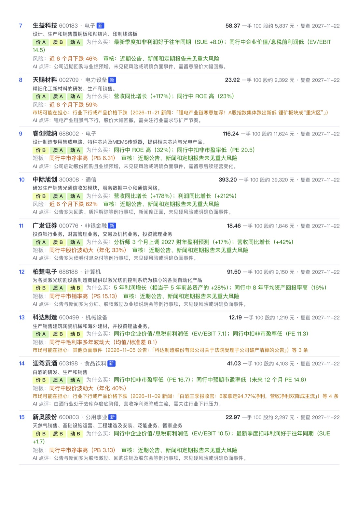
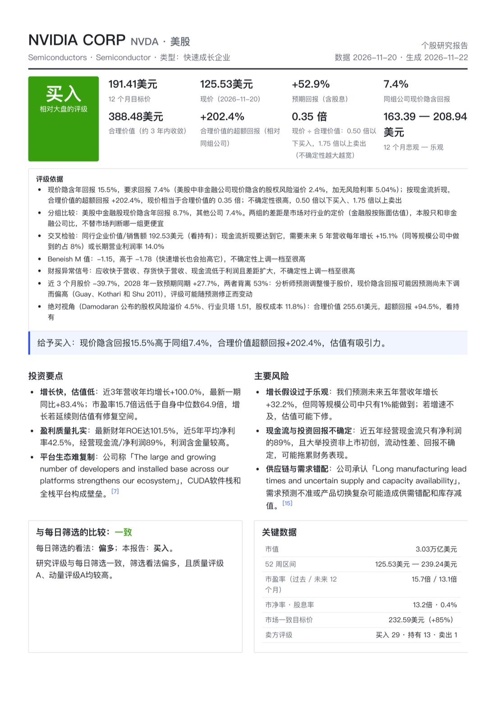
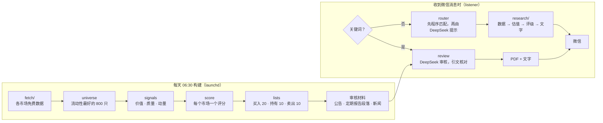

# stock-report

[English](README.md) · **简体中文**

一个基于规则的选股与研究系统：每天为 **A股、美股、港股** 给出 **买入 / 持有 / 卖出** 三档评级，并能为任意一家上市公司
生成 **卖方风格的个股研究报告**。全部使用免费公开数据，每天自动构建，以 PDF 形式通过微信发送。

所有数字都来自程序和公开数据。AI 模型（DeepSeek）只负责阅读公告、新闻和撰写文字，它写下的每一句引文、每一个数字都由程序核对。
整套系统在一台 Mac 上无人值守运行。

> **不构成投资建议。** 这是一个个人研究项目。名单是一套已发表因子方法的机械输出，不是对你的推荐，任何名单都不保证收益。

| 每日筛选报告（第 1 页） | 个股卡片 | 个股研究报告（第 1 页） |
|---|---|---|
|  |  |  |

<sub>示例页面来自 2026-11-22 的构建，原样展示。</sub>

## 目录

- [项目目标](#项目目标)
- [能做什么](#能做什么)
- [工作原理](#工作原理)
- [方法论](#方法论)
- [技术栈](#技术栈)
- [数据来源](#数据来源)
- [自己使用](#自己使用)
- [命令](#命令)
- [目录结构](#目录结构)
- [文档](#文档)
- [版本与发布](#版本与发布)
- [局限](#局限)
- [许可](#许可)

## 项目目标

非专业的个人投资者通常有两个问题：*“现在哪些股票值得持有？”* 和 *“这家公司我该怎么看？”*。专业机构用筛选模型和分析师研报
回答这两个问题。本项目在三个市场上把两者都做出来，不用付费数据，并把答案送到手机上。

**目标刻意定得温和：** 在持有的一年里跑赢该市场的指数基金，风险大致与市场相当。既不是防御型的红利基金，也不是押注少数热门股。

**对预期要诚实。** 这类已发表的因子组合平均每年跑赢指数几个百分点，但大约每 10 年中有 4 年跑输，而且方法公开后超额收益会缩水
（McLean 与 Pontiff，2016：约 −58%）。报告第一页就写明了这一点。

三条原则贯穿所有设计：

1. **借用经过验证的方法，不自创引擎。** 筛选方法改编自已发表的方案（Stockopedia 的 StockRanks、Alpha Architect 的
   Quantitative Value、Greenblatt 的神奇公式、Seeking Alpha 的评分、MSCI 的因子指数），每个市场的指标取自针对该市场的研究，
   从不根据我们自己的回测去调参。
2. **数字归程序，文字归 AI。** AI 从不写价格、预测、目标价、评级或评分。它的文字只能用“键名”引用数字，由程序填入真实值；
   任何其他数字，除非出现在它所引用的原文里，否则一律拒绝。
3. **保持小而免费。** 只用免费公开数据，依赖少而小，不用框架，磁盘占用控制在 2 GB 以内。

## 能做什么

### 1. 每日筛选报告：发送 **股票报告** 或 **股票简报**

约 30 秒内，机器人回复一段文字摘要和一份 PDF。每个市场（A股、美股、港股）各有：

| 评级 | 数量 | 含义 |
|---|---|---|
| 买入 | 20 只 | 预计跑赢大盘。从整个流动性充足的市场中选出，各行业的名额按其在市场中的市值占比分配，等额买入，持有 12 个月。 |
| 持有 | 10 只 | 预计大致平稳：评分居中、大公司里股价最稳的。 |
| 卖出 | 10 只 | 预计跑输大盘：估值贵、质量差或财务风险高的大公司。 |

每只股票一张卡片：价格、**价值 / 质量 / 动量三项评级（A–E）**、入选理由、主要风险、一手的成本、AI 审核在近期公告和新闻里
发现了什么、一句 AI 点评，以及复查日期。每个市场还会说明各档评级的 **预期**：来自历史模拟和已发表的研究。
评级在每月第一份报告时更新；其余日子名单不变、只更新价格，若某只股票新发现硬风险，则由候补替换。

### 2. 个股研究报告：发送代码或名称

发送 `600519`、`0700`、`AAPL`、`贵州茅台`、`茅台`、`腾讯` 或 `nvidia`。几秒内收到确认，约 1–2 分钟后收到文字摘要和一份约
10 页的中文卖方风格报告：

- **评级**（买入 / 持有 / 卖出；若公司无法用免费数据估值，例如尚无收入的生物科技公司，则为不评级）和 **12 个月目标价**，
  附悲观到乐观区间；
- 投资要点、多空观点、未来 3 年预测，以及目标价背后的估值；
- 业务分部、催化剂、风险，以及财报质量检查（Beneish M 值、应计和现金流异常信号）；
- 与每日筛选看法的比较，若差异较大会解释原因。

同时在沪深和香港上市的公司（比亚迪、中国平安）出一份报告，每个上市地各有一个评级。名称有歧义时（平安），机器人会发一个
编号问题让你选。指数、基金、加密货币和未上市公司不在范围内。

### 3. 实盘记录

`track` 逐月把每一期名单与指数基金比较，并核对每一份研究评级后来的表现。方法靠实际记录检验，而不只靠回测。

## 工作原理



- **每日构建。** 每天 06:30，launchd 任务抓取各市场数据，为每只股票打分，生成名单，收集审核要读的材料，并生成一份未审核的
  PDF。工作日几分钟，周日更新基本面时约 30 分钟。
- **关键词回复。** 监听程序轮询微信机器人。收到关键词时运行结果审核（有缓存，约 10 秒），重新生成 PDF 并发送。
- **其他消息** 交给路由：精确代码和全称不经 AI 直接匹配；否则由 DeepSeek 猜测指的是哪家公司，程序再用官方上市名录
  （巨潮、港交所、SEC）确认后才开始工作。研究报告由后台进程生成，监听程序可以继续回复。
- **出错不停摆。** 某个市场构建失败时，显示它最近一次成功的名单及其日期。没有 DeepSeek 时，筛选报告照常发出并标注
  “审核暂不可用”；研究报告照常给出全部数字，文字部分标注“暂不可用”。整份报告永远不会失败。

## 方法论

完整的方法以及每个选择背后的研究依据见 [docs/PLAN.md](docs/PLAN.md)（英文）。简要说明如下：

### 筛选：每个市场一个基于规则的评分

- **股票池。** 每个市场通过流动性门槛后市值最大的 800 只，且至少有 12 个月的价格。只有事实性原因才会剔除股票：与第二数据源
  交叉核对不一致、ST / *ST、停牌、或公告中出现硬风险。其余一律交给评分，所以有问题的公司会排名靠后，而不是消失。
- **评分。** 三大类，等权。每个指标是该股在同行业中的百分位（金融股单独排名）；每一类是其各指标均值的排名；总分是三类的平均。

  | 类别 | 指标（各市场不同，取自针对该市场的研究） |
  |---|---|
  | 价值 | 市盈率倒数（A股用扣非利润）、预期市盈率倒数、市净率倒数、市销率倒数、EBIT/EV、股息率、按 5–8 年平均利润计算的市盈率倒数 |
  | 质量 | ROE（美股用毛利 ÷ 总资产）、利润的现金含量、负债率、8 年平均 ROA、利润率稳定性、低波动、5 年利润增长相对总资产 |
  | 动量 | 12-1 个月股价涨幅（A股改用业绩超预期 SUE，因为 A股研究发现价格动量不赚钱）、利润同比、营收同比、分析师预期上调 |

- **名单。** 买入名单在剔除最可能陷入困境或应计项最大的 5%（Quantitative Value 的做法）后，在每个行业里取评分最高的股票，
  行业名额按自由流通市值占比分配。已入选的股票要跌过入选线的 120% 才会被换掉（MSCI 和中证指数使用的缓冲规则），以降低换手。
  持有和卖出从最大的 400 家里选，每个行业最多 2 只。
- **结果审核。** 筛选中唯一用到 AI 的一步。DeepSeek 阅读每只入选股票近期的非例行公告、最新定期报告的相关段落和近期新闻，
  提出发现，每条都必须引用原文。程序逐字核对每一条引文。公告中的硬风险（造假、资不抵债、已达成的公司出售……）会让这只股票被
  下一只替换；一般性担忧显示在卡片上。
- **预期。** 每个市场的历史模拟，覆盖约 2018 到 2026 年的各个月末，每次方法改动后重跑，从不用来调参。截至 v4.2
  （2026-11-22），买入名单每年跑赢指数基金约：A股 +1.7%、美股 +2.3%、港股 +3.2%，51–60% 的时候跑赢。模拟只含今天仍上市的
  公司（幸存者偏差，报告中已注明），因此只是参考，不是承诺。详见 [docs/BACKTEST.md](docs/BACKTEST.md)。

### 研究报告：按公司类型估值

- **数据表。** 程序为一家公司汇总所有数字：来自监管机构或交易所数据的多年财报（SEC XBRL、东方财富财报表）、每个数字的第二
  数据源（Yahoo）、一致预期、价格、同行，以及 Damodaran 公布的行业数据。
- **按公司类型选择估值方法**（参照 Damodaran 按生命周期的思路）：普通盈利企业、快速成长企业、亏损企业、尚无收入企业、银行、
  保险、券商、周期股、公用事业 / 高股息、REIT 或控股公司。每种类型有自己的主估值方法和交叉检验，例如 10 年 FCFF 现金流折现、
  金融股的账面超额收益模型、周期股按正常年份的现金流折现，或股利折现模型。
- **假设来自测量。** 增长率向基础比率回归，基础比率在数千家公司上测得（同等规模的公司有多少能保持这样的增长）；利润率和超额
  收益按测得的速度衰减；用数据评出的护城河等级决定回报能高于资本成本多久（Morningstar 的三阶段结构）。
- **评级。** 比较现价隐含的回报与整个市场现价在同样规则下隐含的回报（Damodaran 的隐含风险溢价方法），并根据财报质量和风险
  检查放宽不确定性区间。12 个月目标价只收敛到合理价值差距的一部分。
- **文字。** DeepSeek 根据程序提供的数据表和材料，撰写公司业务、投资要点、多空观点、风险和比较。它写的任何数字都必须是数据表
  中的键名，或出现在所引用的原文里；引文逐字核对。

## 技术栈

| 层次 | 使用的技术 |
|---|---|
| 语言与打包 | Python 3.12、[uv](https://docs.astral.sh/uv/)（`uv.lock` 锁定所有版本） |
| 数据与计算 | pandas、httpx（HTTP）、xlrd（读取 Damodaran、中证、港交所的 Excel 文件）、pypdf（公告 PDF） |
| 报告 | Jinja2 HTML 模板，由无头 Google Chrome 渲染为 PDF |
| AI | DeepSeek API（`deepseek-flash`），只有三处窄用途：读懂消息、结果审核、研究报告的文字 |
| 发送 | Node.js 小工具（`bridge/wechat.mjs`），基于 npm 包 `cli-wechat-bridge` |
| 调度 | macOS launchd：06:30 的每日构建和常驻的监听程序 |
| 测试 | pytest，使用保存下来的小样本数据：评分与估值计算、解析器、一次端到端演练 |
| 发布 | GitHub Actions：每次推送到 `main` 时自动打语义化版本标签并撰写发布说明 |

`stockreport/` 中约 12,500 行应用代码，另有 `backtest/` 中的回测工具。

## 数据来源

全部免费公开。`stockreport/fetch/` 中每个模块对应一个数据源；原始下载只临时保存，只保留提取后的小表格。

| 市场 | 价格与行情 | 基本面与预期 | 公告与新闻 | 其他 |
|---|---|---|---|---|
| A股 | 通达信每日数据包、腾讯行情（交叉核对） | 东方财富数据中心（财报、估值、一致预期） | 巨潮资讯公告、东方财富资讯 | 申万行业、沪深300权重、中债10年期收益率 |
| 美股 | Yahoo 行情接口、Nasdaq 选股器 | SEC EDGAR companyfacts（XBRL）、Nasdaq 一致预期、Yahoo（交叉核对） | SEC 公告列表、Yahoo 新闻 | FRED 10年期国债收益率 |
| 港股 | Yahoo 行情接口、腾讯 | 东方财富港股表格（财报、主要指标）、Yahoo 一致预期 | 披露易 HKEXnews、东方财富资讯 | 港交所每手股数、香港政府债券收益率 |
| 研究报告 | | Damodaran 数据集（国家风险溢价、行业贝塔、利润率、评级表） | | |

`crosscheck.py` 每天把各市场的关键数字与第二数据源比对，并对逐日漂移报警。

## 自己使用

这个仓库可以有三种用法：阅读方法、在自己的电脑上运行报告，或改造成自己的版本。

### 环境要求

- macOS（launchd 和 Chrome 路径；其他系统见下文“在其他系统上运行”）、Google Chrome、[uv](https://docs.astral.sh/uv/)
- Node 18+ 和通过 `cli-wechat-bridge` 登录的微信机器人，**仅在** 需要微信发送时
- DeepSeek API 密钥，**仅在** 需要 AI 审核和研究报告文字时

### 快速开始：不用微信、不用 AI，生成一份筛选 PDF

```bash
git clone https://github.com/fanyang0610/stock-report.git
cd stock-report
uv sync
uv run python -m stockreport run --market cn     # 首次运行会回补约 13 个月价格（约 40 分钟）
open reports/$(date +%F)/report.pdf
```

A股不需要任何密钥。美股需要在 `.env` 中加入 `SEC_USER_AGENT` 和 `FRED_API_KEY`；港股不需要。
单家公司：`uv run python -m stockreport research 600519` 会生成 `reports/<日期>/research_600519.pdf`
（没有 DeepSeek 密钥时，文字部分标注“暂不可用”，数字全部都有）。

### 配置：`.env`（永不提交）

| 变量 | 用途 |
|---|---|
| `SEC_USER_AGENT` | 美股数据：你的名字和联系邮箱，SEC 要求提供 |
| `FRED_API_KEY` | 美股无风险利率（FRED 免费申请） |
| `DEEPSEEK_API_KEY` | 结果审核、读懂消息、研究报告的文字 |
| `EQUITYSIGNALS_WECHAT_RECIPIENT_ID` | 微信报告的接收人 |

名单大小、阈值、数据保留期和 DeepSeek 模型都在 [config.toml](config.toml) 中，每项都注明了解释它的方法章节。

### 完整部署：定时通过微信发送

1. 全局安装 npm 包 `cli-wechat-bridge`。`bridge/wechat.mjs` 会在 `~/.npm-global/lib/node_modules/` 下找它
   （或把 `CLI_WECHAT_BRIDGE_TRANSPORT` 设为它的 `wechat-transport.js`）。用 `wechat-setup` 登录机器人，并用
   `node bridge/wechat.mjs status` 检查。
2. 每个市场先完整加载一次：`uv run python -m stockreport fetch --market cn`（以及 `us`、`hk`）。
3. 安装两个 launchd 任务：

   ```bash
   cp launchd/com.stockreport.daily.plist launchd/com.stockreport.listen.plist ~/Library/LaunchAgents/
   launchctl bootstrap gui/$(id -u) ~/Library/LaunchAgents/com.stockreport.daily.plist
   launchctl bootstrap gui/$(id -u) ~/Library/LaunchAgents/com.stockreport.listen.plist
   ```

   plist 中写的是本仓库的绝对路径，如果你的路径不同请修改。卸载任务：
   `launchctl bootout gui/$(id -u)/com.stockreport.daily`（或 `.listen`）。监听程序每次轮询约 55 秒，launchd 在
   10 秒后重启它；同一时间只能有一个进程轮询机器人。微信机器人只能在你最近一次给它发消息后的一段时间内回复，所以如果 `status`
   显示未就绪，先给它发一条消息。日志在 `logs/`。

### 在其他系统上运行，以及改造

- **Linux 或 Windows：** 把 [stockreport/render/\_\_init\_\_.py](stockreport/render/__init__.py) 中的 `CHROME`
  改成你的 Chrome 或 Chromium 路径，用 cron 或任务计划程序代替 launchd 来定时运行 `run`。
- **不用微信：** `run` 和 `research` 会把 PDF 和文字摘要写到 `reports/<日期>/`，你可以用任何方式发送。发送逻辑只在
  `deliver.py` 和 `bridge/` 中。
- **换市场或换方法：** 每个市场的指标和规则连同出处都写在 [docs/PLAN.md](docs/PLAN.md) 中；各市场的代码路径在
  `universe.py`、`signals.py` 和 `research/{cn,us,hk}.py`。
- **配合编程智能体：** [AGENTS.md](AGENTS.md) 记录了本项目开发时遵守的规则（只用免费数据、数字来自程序、一次只做一个阶段），
  可以直接作为 Claude Code 等工具的指令。

## 命令

```bash
uv run python -m stockreport run [--market cn|us|hk]   # 抓取、评分、名单、审核材料、PDF（不用 AI）-> reports/<日期>/
uv run python -m stockreport review                    # 结果审核（DeepSeek），然后生成审核后的 PDF 和摘要
uv run python -m stockreport send [--test]             # 先审核，再发到微信；--test 发送示例数据
uv run python -m stockreport listen                    # 监听程序：关键词回复和路由
uv run python -m stockreport research CODE             # 个股研究报告 -> reports/<日期>/research_CODE.pdf
uv run python -m stockreport research CODE --facts     # 只生成数据表 -> data/research/<市场>/<代码>/facts.json
uv run python -m stockreport research CODE --value     # 只生成估值、目标价和评级 -> valuation.json
uv run python -m stockreport track                     # 成绩单：历期名单对比指数基金，以及研究评级记录
uv run python -m stockreport verdict [CODE veto|confirm --until DATE --reason "..."]   # 你的人工意见（无参数：列出）
uv run python -m stockreport cleanup [--dry-run]       # 执行数据保留规则，显示磁盘占用
uv run pytest                                          # 测试
```

**人工意见（verdict）** 可以在某个日期前把一只股票挡在买入和持有之外（`veto`），或推翻一条一般性担忧（`confirm`）。它从不改变任何数字。

方法改动后刷新“预期”数字：先运行 `uv run python -m backtest.run build cn|us|hk`，再运行
`uv run python -m backtest.qvm frame cn|us|hk` 和 `uv run python -m backtest.qvm run cn|us|hk`
（[docs/BACKTEST.md](docs/BACKTEST.md)）。

## 目录结构

```
stockreport/            应用
  fetch/                每个数据源一个模块
  universe.py           哪些股票参与评分
  signals.py            价值、质量、动量指标；困境概率
  score.py              分类、评分、评级、卡片文字
  lists.py              买入、持有、卖出；缓冲规则和每月评级日历
  review.py             结果审核（配合 passages.py、events.py、quotes.py、notes.py、verdicts.py）
  report.py, render/    HTML -> PDF 和文字摘要
  deliver.py            微信发送；listener.py 回复消息
  research/             个股研究：数据和数据表、估值（value.py、dcf.py、fade.py、market.py）、
                        评级（rating.py、judge.py）、文字（words.py、texts.py）、报告、路由、后台队列
  track.py, history.py  成绩单和多年表格；crosscheck.py 第二数据源核对；cleanup.py 数据保留
bridge/wechat.mjs       微信机器人的 Node 小工具
backtest/               回测工具和数据构建（不属于应用）
launchd/                两个 launchd 任务
tests/                  pytest，小样本数据在 tests/data/
docs/                   方法、回测结果、方法评审、图片、归档
data/ reports/ logs/    缓存和输出（不进 git，控制在 2 GB 以内）
```

## 文档

文档为英文。

| 文件 | 内容 |
|---|---|
| [docs/PLAN.md](docs/PLAN.md) | 方法、每个选择背后的研究、各阶段及其状态。主要参考。 |
| [docs/BACKTEST.md](docs/BACKTEST.md) | 历史模拟：结果，以及生成它们的命令。 |
| [docs/reviews/](docs/reviews/) | 独立的方法评审，其发现推动了后续阶段（2026-11-13 方法评审、2026-11-15 名单检查）。 |
| [AGENTS.md](AGENTS.md) | 编程智能体在本项目上工作的规则（`CLAUDE.md` 指向它）。 |
| [docs/archive/](docs/archive/) | 早期的计划和评审（v0 估值引擎、2026-10-22 计划）。仅供参考。 |

## 版本与发布

版本号遵循 `主版本.次版本.修订号`，以 git 标签保存，说明在 [Releases 页面](https://github.com/fanyang0610/stock-report/releases)。
版本升级的幅度取决于改动对你拿到的结果有多重要：

| 级别 | 何时 | 例子 |
|---|---|---|
| **major 主版本** | 方法或评级的含义改变 | 新的排名方法；名单按不同规则重建 |
| **minor 次版本** | 新功能，或改变了买入、持有、卖出的股票或报告所说的预期 | 完成一个阶段；新增一个评分指标 |
| **patch 修订** | 不改变方法的修复 | 数据解析修复；审核规则更正 |
| **none 不发布** | 应用的行为没有变化 | 文档、测试、回测脚本 |

GitHub Action（[.github/workflows/release.yml](.github/workflows/release.yml)，逻辑在
[.github/release.sh](.github/release.sh)）在每次推送到 `main` 时运行。每个提交用一行尾注 `Release: major|minor|patch|none`
标明级别；没有尾注时自动推断：以 “Stage *n*” 开头且改动应用文件的提交为 minor，其他改动应用文件（`stockreport/`、`bridge/`、
`launchd/`、`config.toml`、`pyproject.toml`、`uv.lock`）的提交为 patch，其余为 none。一次推送中取最高级别，发布标题取自决定该
级别的那次改动。可用 `bash .github/release.sh --dry-run` 预览。从不手动打标签；`pyproject.toml` 中的版本号不使用，最新标签即版本。

### 版本历史

| 版本 | 日期 | 改动 |
|---|---|---|
| v0.1 – v0.5（预发布） | 2026-10-17 → 10-22 | 早期引擎：同行估值、逐股合理价值、盈利预测引擎。未通过自身检验，已被替换，保留作历史。 |
| v1.0 – v1.4 | 2026-11-02 → 11-08 | 现行筛选方法上线：因子评分、各市场买入 / 持有 / 卖出、AI 结果审核、前瞻成绩单。 |
| v2.0 – v2.2 | 2026-11-12 → 11-13 | 个股研究报告：数据表、按公司类型估值和评级、经核对的 AI 文字、微信路由、业务分部。 |
| v3.0 | 2026-11-21 → 11-22 | 根据独立评审重做筛选：四类改为三类、平均利润市盈率、20% 缓冲、卖出重新定义为“又贵又差”。 |
| v4.0 – v4.2 | 2026-11-22 | 研究估值基于测得的假设和市场隐含回报重建；卖出不选动量最强的股票；评级每月更新一次。 |

## 局限

- **免费数据有缺口。** 数据缺失或两个来源不一致的股票会被剔除，而不是猜测。
- **幸存者偏差。** 历史模拟只包含今天仍上市的公司，因此会美化买入、无法检验卖出；报告中已注明。
- **单机运行。** 定时部署是为一台 Mac 和一个微信机器人设计的，不是托管服务。
- **不构成建议。** 评级是对已发表因子方法的机械应用，不了解你的情况；报告也从不建议你如何在股票、基金和债券之间分配资金。

## 许可

目前尚未选择开源许可，因此适用默认版权：你可以在 GitHub 上阅读和 fork 代码，但再利用需要作者许可。如有需要请提交 issue 询问。
